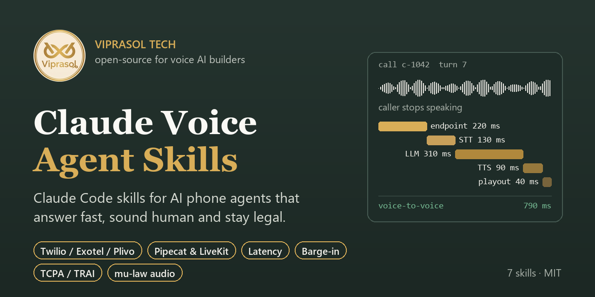

<div align="center">



### Claude Code skills for building AI phone and voice agents

**Architecture · Twilio / Plivo / Exotel · Pipecat & LiveKit · prompting for speech · latency · testing · TCPA / TRAI / EU AI Act · mu-law audio**<br>
The things that make voice agents fail on real calls, handled while you build.

[](https://github.com/Viprasol-Tech/claude-voice-agent-skills/stargazers)
[](LICENSE)
[](https://code.claude.com/docs/en/skills)
[](#-whats-inside)
[](https://github.com/Viprasol-Tech/claude-voice-agent-skills/actions/workflows/ci.yml)

[Quick start](#-quick-start) · [What's inside](#-whats-inside) · [Examples](#-just-ask) · [Scripts](#-bundled-scripts) · [Changelog](CHANGELOG.md)

</div>

---

## 💬 Just ask

Install once, then talk to Claude Code normally. The right skill loads by itself.

```text
> Should we use OpenAI Realtime or Deepgram + GPT + ElevenLabs for a Hindi support line?
> Wire our Pipecat agent to Twilio. It talks over callers when they interrupt.
> Connect the agent to Exotel - the audio has gaps every few seconds.
> Our agent takes 2 seconds to answer. Here are the call logs - where is the time going?
> Rewrite this system prompt so it sounds natural on the phone and confirms phone numbers.
> Build a test suite for our appointment-booking agent before we launch.
> We're starting outbound reminder calls in the US and India. What do we need to comply with?
> Convert our TTS output to 8 kHz mu-law for Twilio on Python 3.13 (audioop is gone).
```

## 📦 What's inside

| Skill | What it does |
| --- | --- |
| 🏗️ **`voice-agent-architecture`** | Cascaded STT→LLM→TTS vs. speech-to-speech (OpenAI Realtime, Gemini Live), Pipecat vs. LiveKit vs. hosted platforms, media streams vs. SIP, endpointing, barge-in, tools, handoff and hosting. |
| ☎️ **`telephony-integration`** | Twilio Media Streams (`media`, `mark`, `clear`), Plivo (`playAudio`, `checkpoint`, `clearAudio`), Exotel Voicebot (PCM16, 320-byte chunk rule), SIP, DTMF, transfers and a troubleshooting table for choppy, robotic or silent audio. |
| 🗣️ **`voice-prompting`** | Prompts for the ear: short spoken replies, read-back of digits and names, one question at a time, interruptions and silence, safe tool calls, human handoff, Hindi-English code-switching. |
| ⚡ **`latency-tuning`** | Per-stage budgets (Twilio's published targets), model-based endpointing, streaming everywhere, co-location, filler speech, and a script that turns call logs into p50/p95 per stage. |
| 🧪 **`voice-agent-testing`** | Text tests, simulated callers, audio pipeline tests, real test calls, scenario suites as data, regression on every change, production monitoring. |
| ⚖️ **`calling-compliance`** | TCPA (AI voices = artificial voice, consent, 8am-9pm, DNC, 2-second opt-out, the November 2026 revocation rules, STIR/SHAKEN), state recording and AI-disclosure laws, TRAI DLT, 140/1600 series and the 2026 A2P rule for AI calls, EU AI Act Art. 50, PECR, PCI on calls, voiceprints. |
| 🎚️ **`audio-formats`** | mu-law vs. PCM16, 8/16/24 kHz, frame and base64 sizes, resampling, and a G.711 converter that works without `audioop` on Python 3.13+. |

Provider and legal facts were checked against Twilio, Plivo, Exotel, OpenAI,
Google, Pipecat, LiveKit, FCC, TRAI, EU and UK sources in **November 2026**,
with links inside each skill.

## ⚡ Quick start

**Option A: Claude Code plugin (recommended)**

```bash
claude plugin marketplace add Viprasol-Tech/claude-voice-agent-skills
claude plugin install voice-agents@claude-voice-agent-skills
```

Skills are then available as `/voice-agents:<skill>` and load automatically
when your request matches.

Want every Viprasol plugin? Add the [Viprasol marketplace](https://github.com/Viprasol-Tech/claude-plugins) once:
`claude plugin marketplace add Viprasol-Tech/claude-plugins`, then
`claude plugin install <plugin>@viprasol`.

**Option B: installer** (copies the skills to `~/.claude/skills`)

```bash
git clone https://github.com/Viprasol-Tech/claude-voice-agent-skills
cd claude-voice-agent-skills
bash install.sh                                        # macOS / Linux
powershell -ExecutionPolicy Bypass -File install.ps1   # Windows
```

No API keys, no accounts, no network calls. The scripts need only Python 3.10+.

## 🧰 Bundled scripts

**`latency_report.py`** - where do the milliseconds go?

```text
$ python latency_report.py events.jsonl --slow 1500
40 turns

stage                           n     p50     p90     p95   (ms)
endpointing + STT final        40     334     426     427
LLM time to first token        40     500     854     876
TTS time to first audio        40     216     278     284
transport / playout            40      77     114     116
VOICE-TO-VOICE                 40    1061    1492    1613
```

**`voice_audio.py`** - telephony audio without `audioop`:

```text
$ python voice_audio.py to-mulaw prompt.wav prompt.ulaw
wrote 8000 bytes (1.00 s of 8 kHz mu-law)
$ python voice_audio.py frames --rate 8000 --ms 20
20 ms of 8000 Hz mulaw = 160 bytes (216 chars base64)
```

## 🗂️ Repository layout

```text
.claude-plugin/marketplace.json          marketplace manifest
plugins/voice-agents/
  .claude-plugin/plugin.json             plugin manifest
  skills/<skill>/SKILL.md                one folder per skill
  skills/audio-formats/scripts/voice_audio.py
  skills/latency-tuning/scripts/latency_report.py
tests/validate_repo.py                   CI: manifests, frontmatter, links, scripts
```

## ⚠️ Disclaimer

These skills are **engineering guidance**, not legal advice. Calling, recording
and AI-disclosure laws differ by country and state and are changing quickly;
confirm your obligations with counsel before making automated calls. Model
names and provider APIs change often; check current documentation. Never paste
real call recordings, personal data or API keys into a chat. Viprasol Tech is
not affiliated with Twilio, Plivo, Exotel, OpenAI, Google, Pipecat, LiveKit,
Anthropic or any regulator mentioned here.

## 🤝 Contributing

Corrections with a link to the provider docs or regulation are the most
valuable contribution. See [CONTRIBUTING.md](CONTRIBUTING.md) and run
`python tests/validate_repo.py` before opening a PR. More free Claude Code
packs from Viprasol:
[claude-tradingview-automation-skills](https://github.com/Viprasol-Tech/claude-tradingview-automation-skills) ·
[claude-crypto-bot-skills](https://github.com/Viprasol-Tech/claude-crypto-bot-skills) ·
[claude-india-stack-skills](https://github.com/Viprasol-Tech/claude-india-stack-skills) ·
[claude-fintech-skills](https://github.com/Viprasol-Tech/claude-fintech-skills) ·
[claude-trading-skills](https://github.com/Viprasol-Tech/claude-trading-skills) ·
[claude-video-editing-skills](https://github.com/Viprasol-Tech/claude-video-editing-skills).

## 📬 Contact — Viprasol Tech Private Limited

Need an AI voice agent for support, sales, collections or appointments - in
English, Hindi or Hinglish? We build and run them.

- 🌐 Website: [viprasol.com](https://viprasol.com)
- ✉️ Email: [support@viprasol.com](mailto:support@viprasol.com)
- 💬 Telegram: [t.me/viprasol_help](https://t.me/viprasol_help) · 📱 WhatsApp: +91 96336 52112
- 🐙 GitHub: [@Viprasol-Tech](https://github.com/Viprasol-Tech) · 💼 [LinkedIn](https://www.linkedin.com/in/viprasol/) · 𝕏 [@viprasol](https://twitter.com/viprasol)

## License

[MIT](LICENSE) © 2026 Viprasol Tech Private Limited
